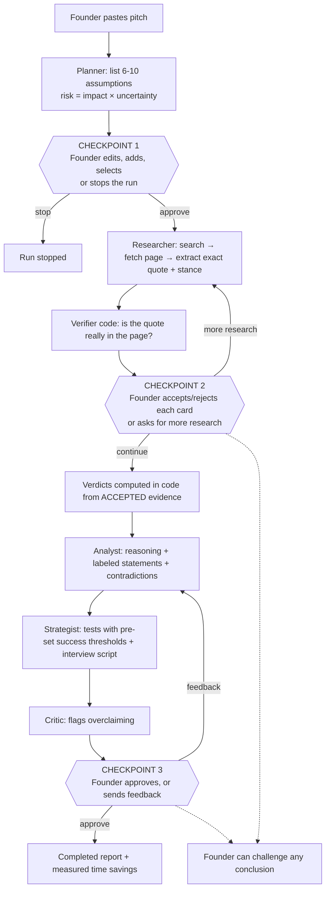
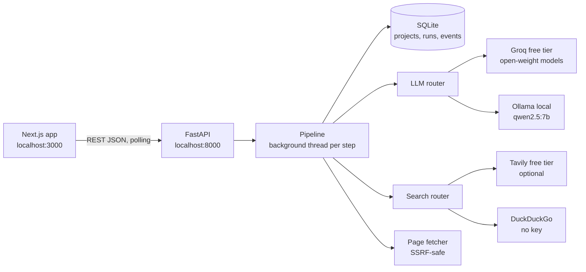

# Premise: architecture

## Design decision: one orchestrated agent with specialised roles, not a multi-agent framework

Premise's work is a known sequence: plan → research → analyse → design tests → critique. Letting agents negotiate
with each other would add cost, latency and failure modes without improving results on small free models.
So Premise uses **one orchestrator (code) that calls the model in narrow roles**: Planner, Researcher, Analyst,
Strategist, Critic. Each role gets one small job and must return JSON that is validated before it is used.

The steps where reliability matters most are **done in code, not by the model**:

| Concern | How it's handled | File |
|---|---|---|
| Invented evidence | A quote only counts as *verified* if it appears verbatim in the fetched page | `backend/app/security.py` → `verify_quote` |
| Overclaiming | A statement labeled "fact" with no accepted source is downgraded to "assumption" | `backend/app/pipeline.py` → `report` |
| Verdicts & confidence | Computed from the evidence the founder accepted (count, agreement, source diversity) | `pipeline.py` → `compute_verdict` |
| Prompt injection | Web text is wrapped in `<untrusted_source>` tags; tag look-alikes are neutralised; prompts forbid following instructions inside | `security.py` → `wrap_untrusted`, `prompts.py` |
| SSRF | Only public http(s) URLs are fetched; every redirect hop is re-checked | `security.py` → `is_safe_url`, `search.py` → `PageFetcher` |
| Rate limits / outages | Groq first; short waits on brief 429s, otherwise fall back to local Ollama | `llm.py` → `LLMRouter` |
| Bad model output | JSON validated with Pydantic; one retry with the validation error, then the next provider | `llm.py` |

## Workflow and human checkpoints

Every checkpoint is **blocking**: the run's status is `awaiting_*`, no background work is running, and the API
returns `409 Conflict` for any action that doesn't match the current checkpoint.

## Components and data flow

- **Run state** is one JSON document per run (assumptions, evidence, analysis, test plan, checkpoints, timings,
  corrections). The **events** table is the live activity feed.
- **Time measurement**: each agent stage records start/end; each checkpoint records when it opened and when the
  founder decided. Assisted time = agent time + review time.

## API

| Method & path | Purpose |
|---|---|
| `GET /api/health` | Which model and search providers are available |
| `POST /api/projects` · `GET /api/projects` · `GET/DELETE /api/projects/{id}` | Projects |
| `POST /api/projects/{id}/runs` | Start an audit (optional `manual_baseline_minutes`) |
| `GET /api/runs/{id}` | Full run state, events, metrics |
| `POST /api/runs/{id}/plan-decision` | Checkpoint 1 |
| `POST /api/runs/{id}/evidence-decision` | Checkpoint 2 (decisions + optional more research) |
| `POST /api/runs/{id}/final-decision` | Checkpoint 3 (approve, or feedback for revision) |
| `POST /api/runs/{id}/challenge` | Ask the agent to defend a conclusion using only the evidence |
| `POST /api/runs/{id}/baseline` | Set the manual-time baseline |
| `GET /api/runs/{id}/report.md` | Markdown export |
| `GET /api/metrics` | Time-savings analytics across runs |
